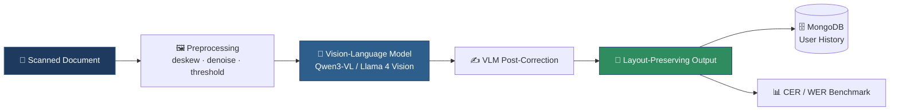
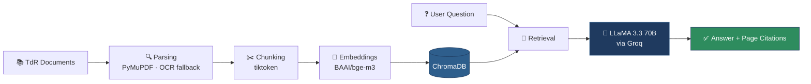
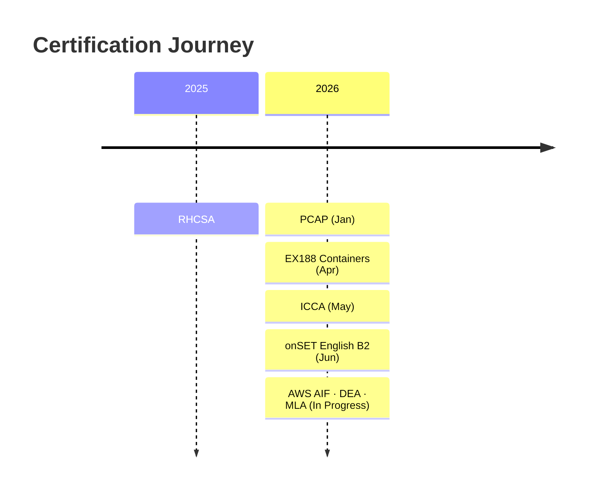
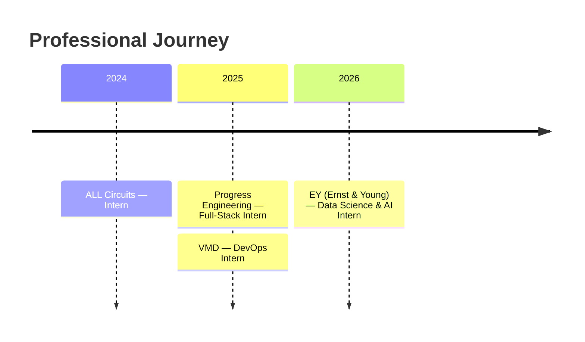
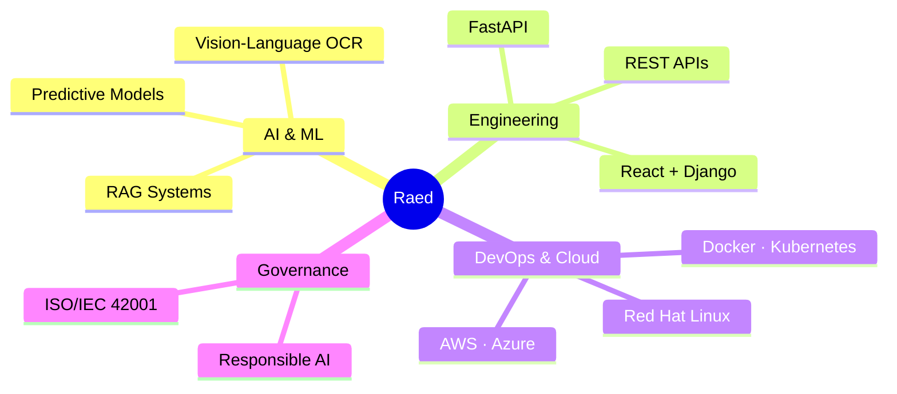

<!-- ===== HERO BANNER ===== -->

  

<!-- ===== TYPING SUBTITLE ===== -->

  

<!-- ===== SOCIAL BADGES ===== -->

  
  
  
  

  
  
  
  

---

## 👨‍💻 About Me

Certified **Data Science & AI** student with a strong foundation in **full-stack development** (React, Django, JavaScript), **DevOps** (Docker, Linux), **machine learning**, and **cloud platforms** (AWS, Azure). Red Hat, PCAP, and ICCA certified, with hands-on internship experience at **EY** and leadership experience through **IEEE** and volunteer work.

I build clean, impactful, and scalable technology solutions.

<table>
<tr>
<td width="60%" valign="top">

| | |
|---|---|
| 🔭 **Currently** | AI document intelligence (RAG + vision-language OCR) at **EY** |
| 🌱 **Learning** | AWS ML / Data Engineering · AI governance (**ISO/IEC 42001**) |
| 🎓 **Studying** | Data Science & AI |
| 🎯 **Looking for** | AI PFE internship — 6 months, Jan 2027 |

</td>
<td width="40%" valign="top">

**🗣️ Languages**

| Language | Level |
|---|---|
| 🇹🇳 Arabic | Native |
| 🇬🇧 English | B2 |
| 🇫🇷 French | B2 |
| 🇩🇪 German | B1 |

</td>
</tr>
</table>

---

## 🛠️ Tech Stack

  
   
  
   
  
   
  

<b>📚 Detailed breakdown</b>

 

| Domain | Technologies |
|---|---|
| **Languages** |       |
| **Frameworks** |      |
| **ML / AI** |       |
| **DevOps & Cloud** |       |
| **Databases** |    |

---

## 📊 GitHub Stats

  
  

  

---

## 🚀 Featured Projects

### 🔎 EY Intelligent OCR — *Multilingual Document Intelligence*

> OCR platform using vision-language models to extract text from **low-quality scanned documents** in French, English, and Arabic — including mixed-language and right-to-left content.

- 🔒 Runs **100% offline on a local GPU** for confidential documents
- 🖼️ Adaptive preprocessing: deskew, denoise, thresholding
- 🤖 VLM post-correction with layout-preserving extraction
- 👤 Per-user document history
- 📏 **CER / WER** benchmarking against a classical OCR baseline

    

---

### 🧠 EY Agentic RAG — *TdR Intelligence*

> RAG platform for querying **hundreds of Tender Reference Documents (TdR)** in French or English, with **exact page-level citations** — aligned with **ISO/IEC 42001** AI management standards.

- 📑 Automatic TdR classification
- 📋 Structure-safe table and bullet reproduction
- 🌍 Bilingual FR / EN querying

    

---

### ⚖️ CSIS — *Criminal Study Intelligent System*

> AI-powered risk assessment and legal intelligence platform for law enforcement and legal researchers.

| 🎯 Risk Prediction | 📖 Legal RAG |
|---|---|
| Predicts criminal-behavior risk and likely crime type | Answers natural-language legal questions with citations |
| **18 behavioral features** | **1,485+ Tunisian law articles** |
| **10,000-record** dataset | TF-IDF retrieval + LLaMA 3.3 (Groq) |

  

---

### 🌱 VigorTerra — *AI Platform for Smart Agriculture*

> Precision-agriculture platform for **Tunisian farmers** that predicts crop yield, disease risk, and land productivity.

- 🌦️ Correlates soil, climate, and historical data from **INM, FAOSTAT, and Open-Meteo**
- 📈 Real-time diagnostics via REST API and interactive dashboard
- 🔁 Experiment tracking with MLflow

   

---

### ⚡ Wizard World — *Full-Stack Companion & E-commerce Platform*

> Digital companion and e-commerce platform for Harry Potter fans, featuring an **AI agent powered by the Grok API**.

- 🛒 Shop, articles, sign-in / account creation, in-site games
- 🏰 Custom Hogwarts-themed design
- 🔐 Improved security and UX

  

---

### 🎮 Console-Based Hangman — *Classic Game in Java*

> Single-player console Hangman with full game logic: input validation, state tracking, and error handling.

  

---

## 📜 Certifications

  
  
  
  
  

| Certification | Date | Status |
|---|---|---|
| onSET English Certificate — B2 | 10/06/2026 | ✅ Certified |
| INE Certified Cloud Associate (ICCA) | 08/05/2026 | ✅ Certified |
| Red Hat Certified Specialist in Containers (EX188) | 07/04/2026 | ✅ Certified |
| PCAP™ — Certified Associate Python Programmer | 27/01/2026 | ✅ Certified |
| Red Hat Certified System Administrator (RHCSA) | 16/07/2025 | ✅ Certified |
| AWS Certified — AI Practitioner, Data Engineer & ML Specialty | — | 🔄 In Progress |
| PL-300 · eJDS (INE) | — | 🔄 In Progress |

---

## 💼 Experience

| Year | Company | Role | Focus |
|---|---|---|---|
| **2026** | **EY (Ernst & Young)** | Data Science & AI Intern | Document intelligence, RAG, AI governance |
| **2025** | **VMD** | DevOps Intern | Docker, Linux, CI/CD |
| **2025** | **Progress Engineering** | Full-Stack Intern | Web application development |
| **2024** | **ALL Circuits** | Intern | — |

---

## 🎯 Focus Areas

---

## 📫 Let's Connect

  
  
  

<i>💡 Always open to discussing AI, cloud, and building things that matter.</i>

<!-- ===== FOOTER ===== -->

  

